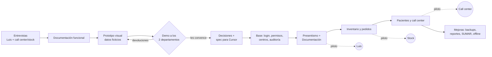
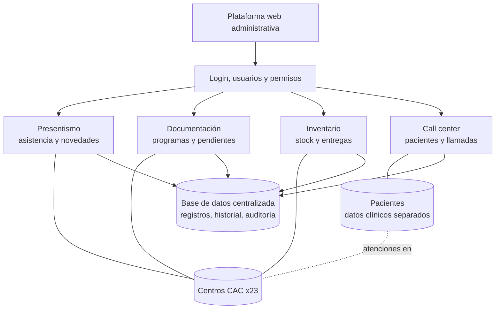
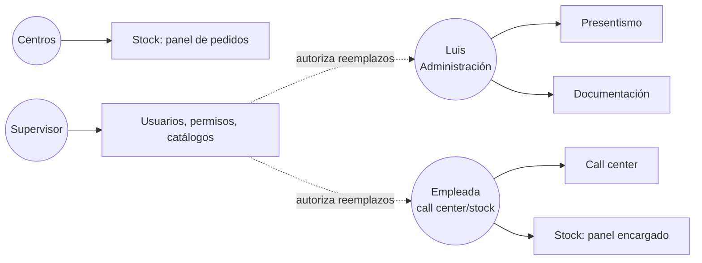
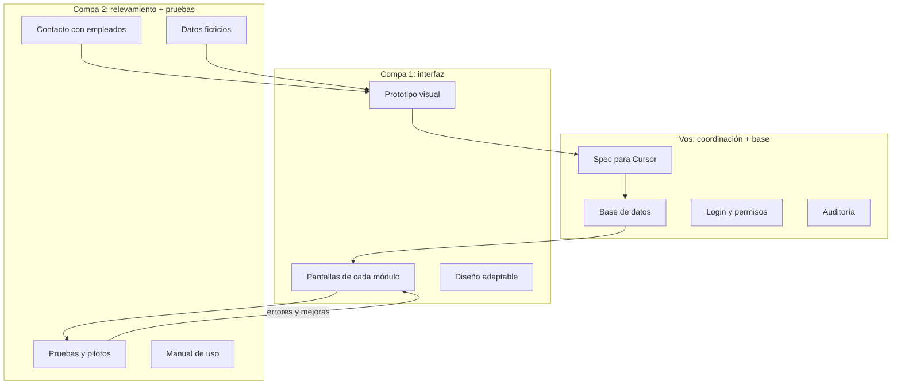

# 03 — Mapa conceptual

> Los diagramas están en Mermaid: se ven en GitHub y en la vista previa de Markdown de Cursor/VS Code. Para presentarlo en pantalla, abrir [`../mapa-conceptual.html`](../mapa-conceptual.html).

## 1. Cómo avanzamos (de la idea al sistema funcionando)

## 2. Qué es el sistema (módulos y relaciones)

## 3. Quién usa qué

## 4. Quién del equipo lleva cada parte

